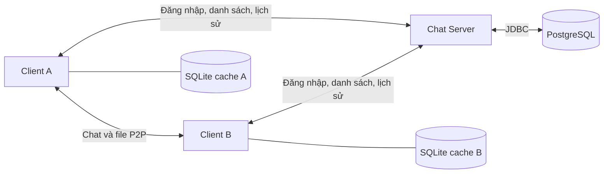

# Kiến trúc Chat P2P

## Thành phần

| Thành phần | Trách nhiệm |
| --- | --- |
| `ChatServer` và `ClientHandler` | Xác thực, danh sách online, tìm peer, nhóm, API lịch sử |
| `PostgresDatabase` | Kết nối PostgreSQL, tạo bảng, lưu và tải lịch sử theo tài khoản |
| `AccountStore` | Hash PBKDF2 cho tài khoản mới, xác thực và nhập `users.dat` cũ |
| `ChatClient` | Kết nối server, P2P, đồng bộ lịch sử, callback giao diện |
| `ChatHistoryStore` | Cache SQLite trên từng client, giữ lịch sử khi mất mạng |
| `HistorySync` | Đẩy cache cũ lên PostgreSQL và tải bản ghi về sau đăng nhập |
| `PeerConnection` / `FileTransferManager` | Truyền chat riêng và byte file trực tiếp qua TCP |
| `CameraCaptureDialog` | Xem trước webcam, chụp PNG và mã hóa video MP4 rồi gửi qua P2P |

Server giữ JDBC URL và thông tin đăng nhập PostgreSQL trong `data/db.properties` hoặc biến môi trường. Client không thấy mật khẩu database. Bảng `accounts` lưu salt và hash PBKDF2, không lưu mật khẩu ứng dụng dạng rõ. Bảng `chat_history` có khóa `(owner, kind, event_id)` để một tin P2P được lưu riêng cho cả người gửi và người nhận mà không bị nhân đôi khi đồng bộ lại.

Client gửi `HISTORY_PUT` sau khi ghi cache cục bộ. Server lấy `owner` từ phiên đăng nhập, không tin trường owner từ client. `HISTORY_GET` trả dữ liệu theo từng trang nhỏ để không vượt giới hạn frame. `HistorySync` ghép bản ghi tải về với cache theo UUID. Nhóm và thành viên nằm trong `chat_groups` và `group_members`; server lưu tin nhóm vào lịch sử của từng thành viên, kể cả người đang offline. Group chat vẫn dùng server và UDP Multicast; direct chat/file vẫn đi qua kênh P2P. PostgreSQL chỉ lưu nội dung tin và metadata file, không lưu byte file.

Các bản ghi ở `users.dat` được nhập theo hash gốc khi server khởi động và file này được giữ nguyên. Server cũng nhập cache SQLite ở chính máy server theo tài khoản đã tồn tại; UUID làm thao tác này lặp lại an toàn. Client ở máy khác đẩy cache của mình lên khi đăng nhập. Nếu PostgreSQL không chạy hoặc cấu hình sai, server báo lỗi lúc khởi tạo. Khi client tạm mất kênh điều khiển, bản ghi trong SQLite vẫn còn để thử đồng bộ sau.
