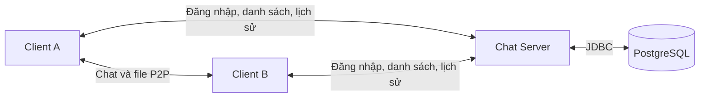

# Kiến trúc Chat P2P

## Thành phần

| Thành phần | Trách nhiệm |
| --- | --- |
| `ChatServer` và `ClientHandler` | Xác thực, danh sách online, tìm peer, nhóm, API lịch sử |
| `PostgresDatabase` | Kết nối PostgreSQL, tạo bảng, lưu và tải lịch sử theo tài khoản |
| `AccountStore` | Hash PBKDF2 cho tài khoản mới và xác thực trực tiếp bằng PostgreSQL |
| `ChatClient` | Kết nối server, P2P, đồng bộ lịch sử, callback giao diện |
| `ChatHistoryStore` | Đọc và ghi lịch sử qua kênh server vào PostgreSQL |
| `PeerConnection` / `FileTransferManager` | Truyền chat riêng và byte file trực tiếp qua TCP |
| `CameraCaptureDialog` | Xem trước webcam, chụp PNG và mã hóa video MP4 rồi gửi qua P2P |

Server giữ JDBC URL và thông tin đăng nhập PostgreSQL trong `data/db.properties` hoặc biến môi trường. Client không thấy mật khẩu database. Bảng `accounts` lưu salt và hash PBKDF2, không lưu mật khẩu ứng dụng dạng rõ. Bảng `chat_history` có khóa `(owner, kind, event_id)` để một tin P2P được lưu riêng cho cả người gửi và người nhận mà không bị nhân đôi khi đồng bộ lại.

Client gửi `HISTORY_PUT` trực tiếp tới server khi có sự kiện mới. Server lấy `owner` từ phiên đăng nhập, không tin trường owner từ client. `HISTORY_GET` trả dữ liệu theo từng trang nhỏ để không vượt giới hạn frame. Nhóm và thành viên nằm trong `chat_groups` và `group_members`; server lưu tin nhóm vào lịch sử của từng thành viên, kể cả người đang offline. Group chat vẫn dùng server và UDP Multicast; direct chat/file vẫn đi qua kênh P2P. PostgreSQL chỉ lưu nội dung tin và metadata file, không lưu byte file.

Nếu PostgreSQL không chạy hoặc cấu hình sai, server báo lỗi lúc khởi tạo. Client cần kết nối server để đọc và ghi lịch sử. File nhận và media tự quay chỉ nằm trong thư mục tạm của hệ điều hành; server chỉ ghi log ra console.
